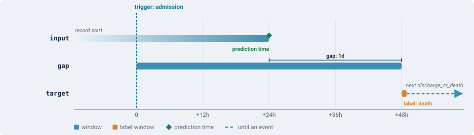
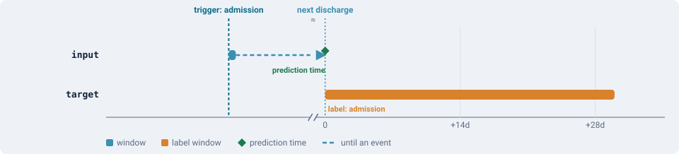

# Taskviz

Draw an [ACES](https://github.com/justin13601/ACES) task configuration as a timeline figure, and put the
task's numbers in a table. The output is plain SVG, Markdown and HTML, made to be put on a website: it is
how a page can show what a prediction task over [MEDS](https://medical-event-data-standard.github.io/) data
looks at, when it predicts, and what it predicts.



The figure is read from the task's YAML alone. No data and no ACES installation are needed for it.

## Install

```bash
pip install "taskviz @ git+https://github.com/rvandewater/Taskviz"
# with ACES, to count a cohort on a MEDS dataset:
pip install "taskviz[extract] @ git+https://github.com/rvandewater/Taskviz"
```

Python 3.11 or newer. The figure and the windows and predicates tables need only `pyyaml` and
`pytimeparse`. Counting existing label files needs `polars` (the `labels` extra), and running ACES needs
`es-aces` 0.8 or newer (the `extract` extra).

## The figure

```bash
taskviz figure examples/tasks/inhospital_mortality.yaml -o inhospital_mortality.svg
```

```python
from taskviz import read_task, render_svg

task = read_task("examples/tasks/inhospital_mortality.yaml")
svg = render_svg(task, theme="auto", title="In-hospital mortality")
```

How to read it:

- The vertical dashed line is the **trigger**, the event each row of the cohort starts from. Time runs left
    to right, in hours, days or years from the trigger.
- Each row is one **window**. A solid bar has both ends at a fixed time from the trigger.
- A bar that **fades out** runs to the start or the end of the subject's record.
- A **dashed arrow** runs until the next (or back to the previous) occurrence of an event, which has no
    fixed place on the axis.
- The **label window** has its own colour and names the label predicate.
- The **diamond** is the prediction time (`index_timestamp`): what lies before it is the model's input.

Four cases get special treatment:

| Case                                                                                                           | Drawn as                                                                                                             | Example                                                                           |
| -------------------------------------------------------------------------------------------------------------- | -------------------------------------------------------------------------------------------------------------------- | --------------------------------------------------------------------------------- |
| An offset far outside the task's timescale (a five-year look-back next to 24-hour windows)                     | Behind a break in the axis (`≈`), compressed, with its real value on the tick                                        | [new_admission_mortality](examples/figures/new_admission_mortality.svg)           |
| A window counted from an event (30 days from the discharge that ends the input window)                         | The event gets its own stretch of the axis after a break, since the time until it is not to scale                    | [readmission_risk](examples/figures/readmission_risk.svg)                         |
| A repeated trigger (`every` / `until`, ACES 0.8)                                                                | Named on the trigger, with a row of small bars, one per prediction time. The windows are drawn for the first one | | [icu_mortality_hourly](examples/figures/icu_mortality_hourly.svg)                 |
| A gap between the prediction time and the start of the label window                                             | Measured out (`gap: 1d`) in the row of the gap window, or before the label window's bar                          | [inhospital_mortality](examples/figures/inhospital_mortality.svg)|



### On a website

The SVG carries its own styles and fonts stack, has no scripts, and scales to its container.

- **As an image:** ``, or `` in
    Markdown. With `--theme auto` (the default) it follows the reader's system light or dark setting.
- **On a site with its own theme switch** (Docusaurus, MkDocs Material): write one file per theme and let
    the site pick, since an image cannot see the page's theme:
    ```bash
    taskviz figure task.yaml --theme light -o task-light.svg
    taskviz figure task.yaml --theme dark -o task-dark.svg
    ```
    In Docusaurus that is `<ThemedImage sources={{light: ..., dark: ...}} />`.
- **Inlined:** paste the SVG into the page, or use `taskviz page` for the figure with its tables as one
    HTML fragment. Every element has a `tv-*` class (`tv-bar`, `tv-trigger`, `tv-index`, ...) scoped to the
    figure, so the page's CSS can restyle it; ids are unique per figure, so several fit on one page.
- `--no-background` leaves out the panel and gives a transparent figure; `--title` adds a heading.

## The tables

```bash
taskviz table examples/tasks/inhospital_mortality.yaml
```

| Window | From                    | To                                  | Requires                             | Role                       |
| ------ | ----------------------- | ----------------------------------- | ------------------------------------ | -------------------------- |
| input  | record start            | trigger + 1d (inclusive)            | at least 5 of any event              | prediction time at its end |
| gap    | trigger (exclusive)     | trigger + 2d (inclusive)            | no admission; no discharge; no death |                            |
| target | trigger + 2d (exclusive) | next discharge_or_death (inclusive) |                                      | label: death               |

`--what predicates` lists what each predicate matches and its role (trigger, label, demographic).
`--format` is `markdown`, `html` or `json`.

## The numbers

Given a MEDS dataset, `taskviz counts` runs ACES with the task and counts the cohort per split:

```bash
taskviz counts examples/tasks/new_admission_mortality.yaml --data /path/to/MEDS --dataset "Synthetic hospital"
```

| Split    | Trigger events | Prediction times | Subjects | Positive labels | Prevalence |
| -------- | -------------: | ---------------: | -------: | --------------: | ---------: |
| train    |            863 |              420 |      420 |              51 |      12.1% |
| tuning   |            170 |               90 |       90 |              13 |      14.4% |
| held_out |            193 |               90 |       90 |              13 |      14.4% |
| Total    |          1,226 |              600 |      600 |              77 |      12.8% |

(These are from a small synthetic dataset.) *Trigger events* are the events matching the trigger before any
window is applied, so the step to *prediction times* shows what the task's criteria remove.

If the labels already exist (from `aces-cli`, MEDS-DEV, or anything else writing MEDS label files), count
them without running ACES:

```bash
taskviz counts task.yaml --labels /path/to/labels
```

```python
from taskviz import extract_counts, count_labels

counts = extract_counts("task.yaml", "/path/to/MEDS", dataset="MIMIC-IV demo")
counts.table(min_count=10).to_markdown()   # or .to_html(), .to_records()
counts.as_dict()                           # plain numbers, for JSON
```

Only aggregate counts are computed and returned; no row of the data is printed or kept. For data that may
not be published at full resolution, `--min-count N` shows every count below `N` as `<N` and leaves out a
prevalence that would give one away. The total of a column with a hidden count is then given as a bound
(`>40`) rather than exactly, so the hidden count cannot be recovered by subtraction.

## Everything on one page

```bash
taskviz page task.yaml --data /path/to/MEDS --dataset "MIMIC-IV demo" -o task.html
```

writes an HTML fragment with the figure, the windows table, the predicates table and the cohort table.
From Python, `render_html(task, counts)` takes one `Counts` or a list of them, one per dataset.

## What it reads

Any ACES task configuration: `predicates`, `patient_demographics`, `trigger` (a predicate name, or the
`{predicate, every, until}` mapping of ACES 0.8) and `windows`. Durations are read with `pytimeparse`, the
parser ACES uses. A window boundary that cannot be read makes `render_svg` raise; `can_draw(task)` says
beforehand. Taskviz does not validate a configuration: ACES does that.

## Where it comes from

The timeline was built for the configuration review page of
[Unearth-AI](https://github.com/McDermottHealthAI/Unearth-Demo), where it is drawn in the browser. This
package is that method as a standalone renderer, extended with event-anchored windows and the tables. The
tasks under `examples/tasks/` marked as such are ACES's sample configurations.

MIT licence.
